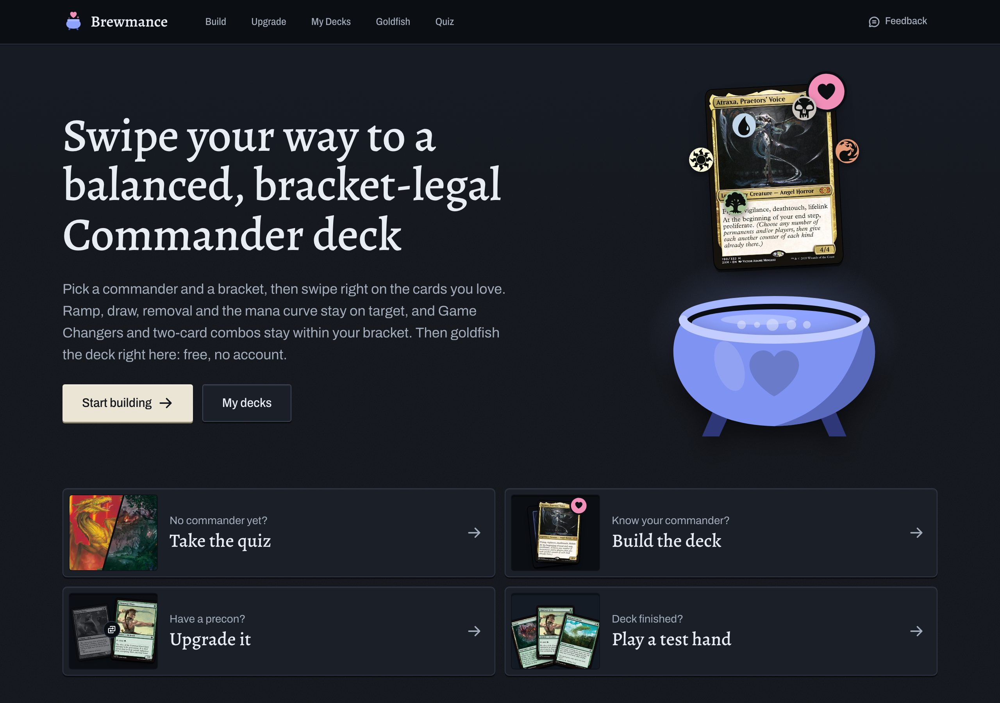

# Brewmance

Build a Magic: The Gathering Commander deck by swiping. Pick a commander, swipe right on the cards you
like, and the deck keeps its mana curve, ramp, card draw and removal in balance while you choose.

**[www.brewmance.app](https://www.brewmance.app)** · free, no account, decks stay in your browser

[](https://www.brewmance.app)

## What you can do

- **Quiz:** no commander yet? Swipe through a few questions and get commanders that fit. There is a track
  for people new to the game and one for players who know their archetypes.
- **Build:** pick a commander and a bracket, then swipe through cards that fit. The suggestions follow what
  decks of that commander play and stay inside the bracket's rules.
- **Upgrade:** start from a precon or a deck you already have. Each swipe is a swap: one card out, a better
  fit in, within a budget you set.
- **Goldfish:** play the deck by yourself in a sandbox with mulligans, tokens, counters and undo.

Decks can be imported, exported as a list and shared as a link.

## Feedback and bugs

I build this in my spare time and read everything that comes in.
[Open an issue](https://github.com/Lzeutschler/brewmance/issues/new) or write to
leonard.zeutschler@45level.com, in English or German.

- For a bug, tell me the commander and the page you were on.
- Your decks only exist in your browser, so I cannot look them up. If the bug is about a deck, use
  **Share** on the deck page and paste the link: it carries the whole list.
- Suggestions that look wrong are worth reporting too, such as a card counted in the wrong role or one
  that should never come up for a commander.

## Where the data comes from

- [Scryfall](https://scryfall.com): card data, images and the tags behind card roles
- [EDHREC](https://edhrec.com): which cards the decks of a commander play, used under EDHREC's data
  policy ([my notes on it](docs/edhrec-data-policy.md), in German)
- [Commander Spellbook](https://commanderspellbook.com): combos, for the bracket check
- [MTGJSON](https://mtgjson.com): the card lists of the precons

Brewmance is not affiliated with any of them.

## Running it yourself

You need Node.js and pnpm.

```bash
pnpm install
```

```bash
pnpm dev
```

The first start downloads card data from Scryfall and EDHREC (about 300 MB) and takes a few minutes.
After that the site runs at http://localhost:3000.

- [docs/development.md](docs/development.md): how the parts work, the data build, project layout, tests
  and deployment
- [docs/design.md](docs/design.md): colors, type, motion and the rules behind them

The other files in `docs/` are my notes, in German.

## License

The code is under the [MIT License](LICENSE): use it, change it, build on it. Card names, card images and
card data are not part of that; they belong to Wizards of the Coast and come from the sources above under
their own terms.

Brewmance is unofficial Fan Content permitted under the Fan Content Policy. Not approved/endorsed
by Wizards. Portions of the materials used are property of Wizards of the Coast. ©Wizards of the Coast LLC.
